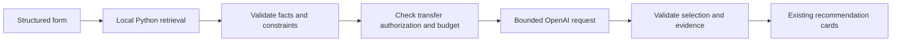

# Saved places to OpenAI integration plan

**Implementation follow-up, 2026-10-19:** [the local evidence contract and mock flow](GENERATION_EVIDENCE.md) now implement the first offline development slice. The bounded projection runs on the Node side after existing private validation, reusing Python unchanged. It has no external transport or browser integration. Live authorization, quality enrichment, attempt accounting and pilot activation below remain proposals.

Prepared 2026-10-19 against local commit `be891a9e322355162319e31cba5f1fb5e7d332d2`. Status: proposal and member 2 handoff, not an implemented connection or permission to send data. This planning task makes no API requests and changes no runtime configuration, credentials or dataset files.

Keep retrieval, geographic filtering and evidence validation local. Add an explicitly enabled generation path that sends a small, reviewed evidence packet to OpenAI, validates the answer and displays it in the existing interface. Start with structured form inputs and one generation call per nonempty eligible search. Add natural-language interpretation after this path works.

## What already works and what is missing

| Local evidence | Consequence for integration |
|---|---|
| [Offline interface](OFFLINE_INTERFACE.md): browser, Node server and isolated Python retrieval already work together | Reuse the current interface, filters and estimates; retain the independent offline launcher |
| [Retrieval handoff](MEMBER_2_RETRIEVAL_HANDOFF.md): 73 saved records; 45 candidates, seven held, 21 excluded | Start from reviewed candidates; do not expand collection for this increment |
| The same handoff reports 42/45 candidate descriptions missing; verified source links, description languages and reuse references absent | A nullable contract is necessary, but cannot supply the missing information or complete the description requirement |
| [Python adapter](../scripts/data/retrieval_json_adapter.py) rejects collected snapshots in `app-v1`; the private envelope has `external_processing_allowed=false` | Changing the retrieval command alone cannot enable live use |
| [Live validation](../src/shared/validate.mjs) requires descriptions and description evidence, source links and reuse references | Introduce an explicit versioned projection and validator; preserve existing private and legacy contracts |
| [OpenAI adapter](../src/app/openai.mjs) implements structured interpretation and recommendation requests; [service](../src/app/service.mjs) interprets before retrieval | Current live flow could spend an interpretation call before discovering that private retrieval is incompatible |
| The model currently selects IDs, evidence, reason codes and activity codes; [presentation](../src/app/presentation.mjs) renders fixed localized wording | Real provider selection would be constrained recommendation generation, not model-written place-specific prose |

Counts above are previously recorded aggregate evidence, not a new inspection of private rows. Current model access, balance, compatibility, pricing and provider data handling were not checked in this task. Existing tests demonstrate offline behavior; full [acceptance checks](../ACCEPTANCE_TESTS.md) remain separate.

## Privacy and external processing

Working assumption: “private” means the full dataset stays outside Git, public hosting, shared documents and provider storage uploads. A later real OpenAI request necessarily sends its selected evidence to OpenAI. If every place fact must stay on the computer, use the existing offline mode; the proposed external generation path cannot satisfy that stricter condition.

The source's storage, AI-processing and redistribution terms remain unresolved in the [preflight](2GIS_PREFLIGHT.md). No new permissions inquiry or collection is part of this plan. Before activation, record the applicable source-use basis and the operator's explicit decision about the disclosed provider transfer. A local authorization record documents that decision; it does not establish legal rights or turn unresolved permission into a verified fact. Public demo/redistribution eligibility is a separate decision.

Preserve original snapshots and their false eligibility flags. Use a separate, ignored local configuration for any later authorized projection, bound to exact snapshot, review and policy hashes, approved records/fields, provider and purpose. Missing, stale or incompatible authorization must cause zero outbound calls. No browser parameter may enable generation or choose a dataset, provider, command or model.

| Keep local | Proposed provider packet |
|---|---|
| Full snapshot, source responses, reviews, ledgers, private paths and stable ID mapping | At most five eligible candidate aliases, names and approved source-backed categories |
| Exact start and POI coordinates, raw query and location history | Selected form preferences, time budget and coarse computed distance/time estimates |
| Raw hours, contacts, ratings, reviewer prose and unused fields | Source description only when present and approved; compact field evidence references; explicit unknowns and allowed reason/activity codes |
| Keys and provider configuration | No secrets, URLs to private files or tool access |

Candidate aliases are mapped back to stable IDs locally. They are not anonymization: place names, descriptions, categories and relative distances can reveal the search area. The UI must disclose this before an enabled generation request. The first version sends no free-text query or lexical search terms; those remain local.

The current adapter sets `store:false`. That setting alone is not evidence of zero provider retention. Verify current official OpenAI documentation and account settings before activation; record the applicable handling without promising unsupported privacy guarantees. Do not upload a snapshot, create a hosted vector store, request embeddings or add a map call for this integration. Local lexical/geographic retrieval is enough for the first flow.

## Proposed implementation sequence

### 1. Agree the generation contract and evidence projection

The local mock increment now implements `qadam-generation-evidence-v1` with its own validation path and synthetic examples, documented in [CONTRACTS.md](CONTRACTS.md). Member 2 owns review and adoption for any later external generation path; the implemented contract remains explicitly local-only.

Validate the original private retrieval result first. A separately authorized projector then selects only approved fields and candidates, retaining internal source-version and field-level evidence links. Never reinterpret the existing private envelope as online permission or route collected records through the synthetic adapter.

Allow genuinely missing descriptions, description languages and source URLs to stay null. Name/category evidence can support a modest category-based recommendation; it cannot support history, atmosphere, facilities or cultural significance. Separate original source rubrics, deterministic category mappings, reviewer judgments and time estimates. Retain review qualifications such as unconfirmed seating or entrances in local presentation and constrain generation accordingly.

Output remains a bounded list of candidate aliases, evidence references and allowed reason/activity codes for the first version. Validate alias membership, uniqueness, field/version correspondence and allowed claims before mapping back to local POIs. Source attribution comes from local records, never model-generated links. Enable the existing `first_visit` description reason only for a record with an actual supporting description.

### 2. Build one generation call after local retrieval

Empty results, invalid bindings, missing configuration or authorization failures stop before provider dispatch. Local checks retain full-precision radius/time calculations, return/buffer accounting, hard constraints and unknown-field behavior. Each card stays an alternative; three cards do not imply a combined route.

Reuse the existing provider transport where suitable, retaining a fixed OpenAI endpoint and adding redirect rejection at the outbound boundary. Keep the first path on form controls and optional local lexical ranking. Label these controls clearly: written keywords do not interpret hard requirements. Keep map loading disabled so the initial generation trial has only one external provider.

Provider failure, refusal, malformed output or unsupported IDs/evidence yields visibly labeled retrieval-only results. No success label on a mock, synthetic record, failed generation or template-only path. Live cards should say that AI selected options and the application rendered the wording; source facts, activity suggestions and estimates remain distinct.

### 3. Prove the boundary offline

Use authored synthetic records and injected provider doubles. Block external networking and omit credentials from tests. A payload-preview operation may later render the exact proposed request in the user's local application, without submitting it or including it in agent/browser screenshots, Git or public logs. Private evaluation reports contain aggregates only.

| Test group | Required behavior |
|---|---|
| Contract and authorization | Private/legacy/synthetic envelopes cannot cross into generation accidentally; missing authorization, changed hashes or unauthorized fields produce zero calls |
| Nullable evidence | Missing description/link/language stays null; name/category cannot authorize historical, opening, quietness, socket, seating or accessibility claims |
| Retrieval adaptation | Location, radius, categories, time, return and buffer change eligibility correctly; hard unknown amenities/opening fail; no match means zero generation calls |
| Grounding and injection | Reject invented/duplicate IDs, wrong evidence versions, unsupported reason/activity codes and extra prose; malicious source instructions cannot redirect requests or outputs |
| Data minimization | Exact outbound body has only allowlisted fields; no coordinates, raw query, full records, paths, credentials or reviewer text; render source text safely |
| Failure and accounting | Timeout, rate limit, refusal, oversized/malformed output and ambiguous network failure use fallback; dispatch attempts remain counted across restarts; concurrent submits cannot overspend |
| Separation and integrity | Existing offline launcher remains network-free; legacy tests retain their protections; source/review/collector-ledger hashes remain unchanged |
| User-facing labels | Live selection, retrieval-only fallback, synthetic tests and no match are distinguishable; sources, unknowns and estimates remain visible in RU/KK/EN |

Run the relevant Node/Python suites, bridge checks and configured syntax checks after implementation. Reuse the existing 45-case private interface evaluation for scenario regression, keeping its aggregate-only output and integrity checks; do not build a duplicate evaluation framework. Member 3 reviews acceptance evidence for AT-02/03/06–11/14; fixture success does not establish live behavior, source rights or first-visitor usefulness. The completed local increment's test evidence is recorded in [GENERATION_EVIDENCE.md](GENERATION_EVIDENCE.md).

### 4. Review evidence quality for the three scenarios

Before a live scenario trial, inspect results locally for a short walk, coffee/rest stop and first-time visitor discovery. Select tests by expected behavior, not hardcoded venue answers. Review coverage, relevance, source description quality and unsupported assumptions. Retain held/excluded records as they are.

The present sparse data can support limited name/category-based selection, but does not close AT-05's description requirement or prove AT-14's useful first-visitor explanations. Identify enough genuine descriptive evidence for the intended demonstration. If the saved descriptions are insufficient, propose separately permitted, attributed enrichment with its own provenance and acquisition authorization. Do not generate replacement descriptions and label them source facts, or collect more places automatically.

Only after this quality review consider richer generated explanations. Factual prose requires a separately reviewed output/evidence design and human evaluation; an evidence ID alone does not prove a sentence is supported. The initial code-selection schema deliberately avoids that claim-validation problem. It must be described accurately in the presentation.

### 5. Activate a small pilot only in a later authorized task

Before any live request, verify the chosen model's availability and structured-output support, account budget and current provider data controls. Use existing server-only `OPENAI_API_KEY` and `OPENAI_MODEL` configuration as appropriate; no credential values in chat, client bundles or diagnostic output. Model choice and current cost are deliberately undecided.

Proposed pilot: **three total generation attempts**, one at a time for the three core scenarios, reviewing the first result before proceeding. This is a proposal, not a request allowance. Start with an agreed candidate subset, five candidates maximum, the existing 1,800 output-token bound and 15-second timeout as initial settings subject to model compatibility checks. Bound serialized request size as well; reject oversized evidence before dispatch. No automatic retries, repair calls, fallback-model calls, account-test calls, embeddings or background generation.

Reserve each attempt atomically before dispatch in a separate ignored local ledger. Count failures/timeouts/uncertain outcomes as used; preserve the ceiling across restart and concurrent submissions. Store only run identity, attempt number, time, outcome and returned usage/latency when available, not prompts, records or precise locations. An attempt cap and token limits bound activity; they are not an exact monetary guarantee. Confirm a separate spending ceiling after model pricing is verified. Existing 2GIS accounting remains unchanged.

Proof of a successful trial: local retrieval precedes the real configured call, returned selections map only to that request's candidates/evidence, constraints remain enforced, the UI shows honest provenance/uncertainty, and aggregate evidence records the provider outcome. One successful request proves a connection, not all hackathon acceptance checks or permission for publication/recording.

### 6. Add natural-language interpretation after the first flow passes

The current natural-language path normally needs interpretation plus generation: two calls on a successful request with candidates. Treat that as a separate budgeted feature. Check local dataset/configuration readiness before interpretation; count interpretation even if it later produces clarification or no match. Then merge intent without relaxing form hard constraints, retrieve locally and generate only for eligible results.

Unlike the first slice, this sends user text to OpenAI. Existing decimal-coordinate redaction is best effort and does not reliably remove addresses, names or other personal details. Update the disclosure and payload tests before enabling it. Do not represent lexical ranking as semantic interpretation or claim that regex redaction anonymizes a prompt.

## Ownership and next deliverable

| Owner | Next scoped work |
|---|---|
| Member 1 | Data/evidence semantics, synthetic fixtures, private aggregate quality audit and immutable source checks; maintain existing Python retrieval. The user-authorized local evidence projection is implemented in Node; coordinate subsequent application changes with member 2 |
| Member 2, integration lead | Approve shared contract; implement explicit service/provider gate, configuration, budget accounting, validation, UI/disclosure and application tests in owned paths |
| Member 3 | Independent integration/privacy/grounding scenarios, clean setup and truthful live-demo/submission evidence |

Follow [TEAM_WORKFLOW.md](../TEAM_WORKFLOW.md): separate implementation branches/worktrees and agreed ownership; each handoff records commit, files, contract/configuration changes, tests and outstanding limitations. No dataset transfer is included in this handoff. A clean checkout uses synthetic fixtures until separately provisioned with authorized local data.

**Next integration deliverable:** member 2 reviews the implemented local contract and mock flow, then designs the separate provider authorization/transport boundary with outbound calls still disabled during development. The local implementation grants no external request budget.
